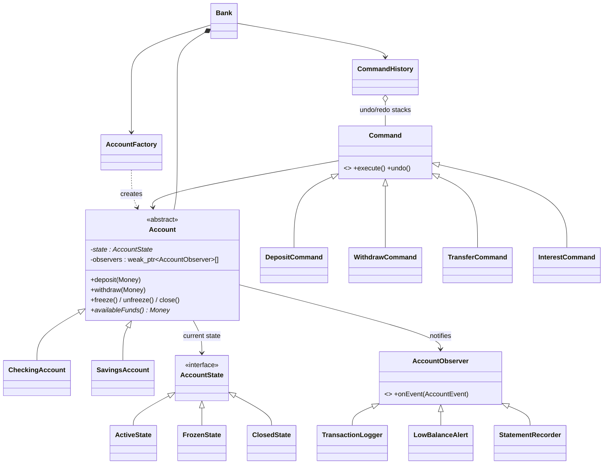

# BankSystem: design patterns in C++

A small bank account system written in C++17 for the *Production Software
Engineering* design patterns assignment. You can open checking and savings
accounts, deposit, withdraw, transfer, pay interest, freeze and close
accounts, and **undo/redo** transactions. Each feature is built around a
classic Gang of Four design pattern.

| Requirement     | Where                                                          |
|-----------------|----------------------------------------------------------------|
| Source code     | `src/bank/` (library), `app/main.cpp` (demo)                   |
| Design patterns | State, Command, Observer, Factory (see below)                  |
| CMake           | `CMakeLists.txt`, `src/`, `app/`, `tests/`, `cmake/`           |
| Version control | Git, one commit per feature (`git log --reverse`)              |
| Unit tests      | `tests/`: 46 GoogleTest tests, ~97% line coverage              |

## Build and run

Requirements: a C++17 compiler (GCC, Clang or Apple Clang), CMake 3.16+ and
Git. GoogleTest is downloaded automatically if it is not installed.

```bash
cmake -S . -B build                      # configure (out-of-source)
cmake --build build                      # compile
ctest --test-dir build --output-on-failure   # run the unit tests
./build/app/bank_demo                    # run the demo scenario
```

On macOS: `xcode-select --install` (compiler) and `brew install cmake`.

Optional test coverage report (needs `lcov`, e.g. `brew install lcov`):

```bash
cmake -S . -B build-cov -DBANK_ENABLE_COVERAGE=ON
cmake --build build-cov --target coverage    # report in build-cov/coverage/index.html
```

## Project structure

```
CMakeLists.txt            top-level build: options, C++17, subdirectories
cmake/                    compiler warnings and coverage helpers
src/bank/                 the bank_core library
  Money                   exact money amounts (integer cents)
  Errors                  exception hierarchy (BankError, InsufficientFunds, ...)
  Account                 Account, CheckingAccount, SavingsAccount
  AccountFactory          Factory pattern
  AccountState            State pattern (Active, Frozen, Closed)
  AccountObserver         Observer pattern (logger, alert, statement)
  Command                 Command pattern (transactions, undo/redo history)
  Bank                    ties everything together
app/main.cpp              bank_demo: walk-through of every pattern
tests/                    GoogleTest unit tests, one file per component
.gitlab-ci.yml            CI pipeline (build, test, coverage)
.github/workflows/ci.yml  the same on GitHub (Linux + macOS)
```

## Design patterns



### State: what an account may do (`AccountState.hpp`)
*Problem:* a frozen account must not allow withdrawals, a closed one must not
allow anything. With a status flag every method becomes
`if (frozen) … else if (closed) …`.
*Solution:* each state is a class (`ActiveState`, `FrozenState`, `ClosedState`)
and `Account` forwards every operation to its current state object. The base
class rejects everything, so each state only overrides what it allows. The
states hold no data, so one shared instance of each serves all accounts.

| operation | Active      | Frozen      | Closed |
|-----------|-------------|-------------|--------|
| deposit   | yes         | yes         | no     |
| withdraw  | yes         | no          | no     |
| freeze    | → Frozen    | no          | no     |
| unfreeze  | no          | → Active    | no     |
| close     | → Closed\*  | → Closed\*  | no     |

\* only with a zero balance

### Command: transactions with undo/redo (`Command.hpp`)
*Problem:* a plain `account.withdraw(x)` call cannot be undone, stored or
listed.
*Solution:* every transaction is an object with `execute()` and `undo()`.
`CommandHistory` (the *invoker*) keeps undo and redo stacks. Undo is a
reversing operation through the normal account API, like a bank reversal
entry, so the rules still apply: a deposit on a frozen account cannot be
undone until it is unfrozen. A transfer is all or nothing.

### Observer: reacting to account activity (`AccountObserver.hpp`)
*Problem:* logging, alerts and statements should not be hard-coded into
`Account`.
*Solution:* the account (the *subject*) sends an `AccountEvent` to all
registered observers after every successful operation. New reactions are new
observer classes, and `Account` does not change. Observers are stored as
`std::weak_ptr`, so the account never keeps them alive and never calls a
destroyed one.

### Factory: creating accounts (`AccountFactory.hpp`)
*Problem:* callers should not have to know the concrete account classes or
their default settings.
*Solution:* `AccountFactory::create(AccountType, id, owner)` returns a
`std::unique_ptr<Account>`. It is the only place that knows `CheckingAccount`,
`SavingsAccount`, the overdraft limit and the interest rate.

### Design principles applied
- **Program to an interface:** `Bank` works with `Account&`, `Command` and
  `AccountObserver`, not with concrete classes.
- **Open-Closed:** new states, commands or observers are new classes; existing
  code does not change.
- **Single responsibility:** money arithmetic (`Money`), rules per state,
  reactions per observer, and creation in the factory each live in their own
  class.
- **Encapsulate what varies:** the allowed operations (state), the reactions
  (observers) and the transactions (commands).
- **Favor composition over inheritance:** an account *has* a state and *has*
  observers.

### Other decisions
- **Money is stored as integer cents**, not `double`, so `0.10 + 0.20 == 0.30`
  exactly (there is a test for this).
- **Errors are exceptions** with specific types, so the caller and the tests
  can tell `InsufficientFunds` from `InvalidOperation`.
- Accounts are **non-copyable**: each one is a unique entity.

## Tests

`ctest --test-dir build` runs 46 GoogleTest unit tests:

| File                   | Tests                                                   |
|------------------------|---------------------------------------------------------|
| `MoneyTest.cpp`        | exact arithmetic, formatting, parsing invalid input     |
| `AccountTest.cpp`      | deposits, withdrawals, overdraft, interest, factory     |
| `AccountStateTest.cpp` | every state transition, allowed and rejected operations |
| `ObserverTest.cpp`     | notifications, weak references, logger, alert, statement |
| `CommandTest.cpp`      | undo/redo, rollback of failed transfers, history rules  |
| `BankTest.cpp`         | the whole flow across several accounts                  |

## Git history

Each feature was developed and committed separately:

```bash
git log --reverse --oneline
```

1. CMake project with GoogleTest
2. `Money` value type and the error hierarchy
3. Checking/savings accounts and the Factory
4. Account states with the State pattern
5. Observers
6. Transactions with undo/redo (Command pattern)
7. `Bank` and the demo program
8. Continuous integration (GitLab + GitHub)
9. This README
